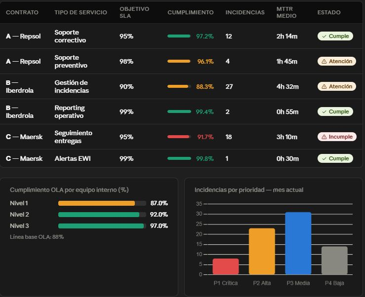
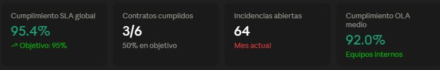
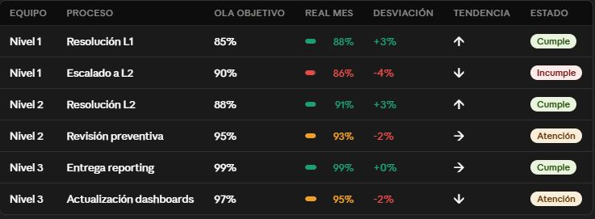

# 📊 Dashboard OLA & ANS/SLA — Gestión de Niveles de Servicio

**Power BI · DAX · Star Schema · KPIs Operativos · Early Warning Indicators**

> **Datos 100 % sintéticos** (56 incidencias de ejemplo, junio de 2026), incluidos en `/data` para que el dashboard sea reproducible.



---

## 📋 Descripción

Cuadro de mando completo para el seguimiento de **OLA (Operational Level Agreements)** y **ANS/SLA (Acuerdos de Nivel de Servicio)** en operaciones de gestión de servicios. Orientado a responsables de operaciones, gestores de contratos y equipos de soporte técnico.

**Casos de uso reales:**
- Control de cumplimiento de SLA por contrato de cliente
- Seguimiento de OLA por equipo interno (Nivel 1 / 2 / 3)
- Detección temprana de incumplimientos antes de penalización
- Reporting operativo para reuniones de revisión de servicio

---

## 🏗️ Modelo de Datos — Star Schema

```
                    ┌─────────────────┐
                    │  dim_calendario │
                    │  (27 fechas)    │
                    └────────┬────────┘
                             │
         ┌───────────────────┼───────────────────┐
         │                   │                   │
┌────────▼────────┐ ┌────────▼────────┐ ┌────────▼──────────┐
│  dim_contratos  │ │fact_incidencias │ │   dim_equipos     │
│  (6 contratos)  ├─┤  (56 registros) ├─┤  (6 procesos OLA) │
│  SLA targets    │ │                 │ │  OLA targets      │
└─────────────────┘ └─────────────────┘ └───────────────────┘
```

**Tablas:**

| Tabla | Tipo | Registros | Descripción |
|-------|------|-----------|-------------|
| `fact_incidencias` | Hechos | 56 | Incidencias con tiempos de respuesta y resolución |
| `dim_contratos` | Dimensión | 6 | Contratos de cliente con objetivos SLA por prioridad |
| `dim_equipos` | Dimensión | 6 | Equipos internos con objetivos OLA por proceso |
| `dim_calendario` | Dimensión | 27 | Calendario junio 2026 con flags laborables |

---

## 📄 Páginas del Dashboard

### 1. Resumen Ejecutivo
KPIs globales: SLA global %, incidencias abiertas, MTTR medio, contratos en objetivo. Semáforos EWI automáticos. Filtros por contrato y equipo.

### 2. ANS/SLA por Contrato
Cumplimiento detallado por contrato: % respuesta vs objetivo, % resolución vs objetivo, MTTR por prioridad, penalizaciones en riesgo. Gráfico de tendencia rolling 7 días.

### 3. OLA por Equipo Interno
First Time Fix Rate por equipo. Tasa de reapertura. Cumplimiento OLA por proceso. Comparativa Nivel 1 / 2 / 3.

### 4. Análisis de Incidencias
Distribución por prioridad (P1-P4). Mapa de calor por día/equipo. Top incidencias por tiempo de resolución. Análisis de incumplimientos.

---

## 🧮 Medidas DAX Destacadas

### SLA Global ponderado
```dax
SLA Global % =
([Cumplimiento SLA Respuesta %] * 0.4) + ([Cumplimiento SLA Resolucion %] * 0.6)
```

### EWI con brecha dinámica
```dax
EWI SLA Alerta =
VAR _sla = [SLA Global %]
VAR _objetivo = 0.95
VAR _brecha = _objetivo - _sla
RETURN
    IF(_brecha <= 0, "En objetivo",
    IF(_brecha <= 0.03, "⚠️ Riesgo leve — brecha " & FORMAT(_brecha, "0.0%"),
    "🚨 Incumplimiento — brecha " & FORMAT(_brecha, "0.0%")))
```

### MTTR con formato legible
```dax
MTTR Formato =
VAR _horas = INT([MTTR Horas])
VAR _minutos = INT(([MTTR Horas] - _horas) * 60)
RETURN _horas & "h " & _minutos & "m"
```

### Cumplimiento SLA respuesta por prioridad
```dax
Cumple SLA Respuesta =
COUNTX(
    FILTER(
        fact_incidencias,
        VAR _p = fact_incidencias[prioridad]
        VAR _tr = fact_incidencias[tiempo_respuesta_min]
        VAR _objetivo =
            SWITCH(_p,
                "P1", RELATED(dim_contratos[sla_respuesta_p1_min]),
                "P2", RELATED(dim_contratos[sla_respuesta_p2_min]),
                "P3", RELATED(dim_contratos[sla_respuesta_p3_min]),
                999)
        RETURN _tr <= _objetivo
    ),
    fact_incidencias[id_incidencia]
)
```

Ver todas las medidas en [`/dax/medidas_ola_sla.md`](./dax/medidas_ola_sla.md)

---

## 🔑 Técnicas DAX Aplicadas

| Técnica | Medida | Para qué |
|---------|--------|----------|
| `SWITCH` + `RELATED` | Cumplimiento SLA | Objetivo dinámico según prioridad de incidencia |
| `COUNTX` + `FILTER` | Cumplimiento SLA | Contar filas que cumplen condición compleja |
| `DATESINPERIOD` | Rolling 7D | Tendencia de incidencias últimos 7 días |
| Variables DAX | EWI / MTTR | Legibilidad y reutilización de cálculos |
| `FORMAT` + concatenación | Títulos dinámicos | Contexto de selección en título del visual |
| Medidas ponderadas | SLA Global | Combinar respuesta (40%) y resolución (60%) |

---

## 🚀 Cómo Replicar el Dashboard

1. Descarga los 4 CSVs de la carpeta `/data/`
2. En Power BI Desktop: **Obtener datos → Texto/CSV** → importa los 4 archivos
3. En el **Editor de Power Query**: verifica tipos de columna (especialmente `id_fecha` como entero)
4. Crea las **relaciones** en la vista de modelo:
   - `fact_incidencias[id_contrato]` → `dim_contratos[id_contrato]`
   - `fact_incidencias[id_equipo]` → `dim_equipos[id_equipo]`
   - `fact_incidencias[id_fecha]` → `dim_calendario[id_fecha]`
5. Copia las medidas DAX desde `/dax/medidas_ola_sla.md`
6. Construye los visuales según las páginas descritas

---

## 📁 Archivos

```
ola_sla_project/
├── README.md
├── data/
│   ├── fact_incidencias.csv      ← 56 incidencias con tiempos reales
│   ├── dim_contratos.csv         ← 6 contratos con SLA targets por prioridad
│   ├── dim_equipos.csv           ← 6 procesos OLA por equipo interno
│   └── dim_calendario.csv        ← Calendario junio 2026
├── dax/
│   └── medidas_ola_sla.md        ← 9 bloques DAX documentados (25+ medidas)
└── capturas/                     ← páginas del dashboard
```

---

## 📸 Capturas

| Control de niveles (KPIs) | Acuerdos internos (OLA) |
|---|---|
|  |  |
