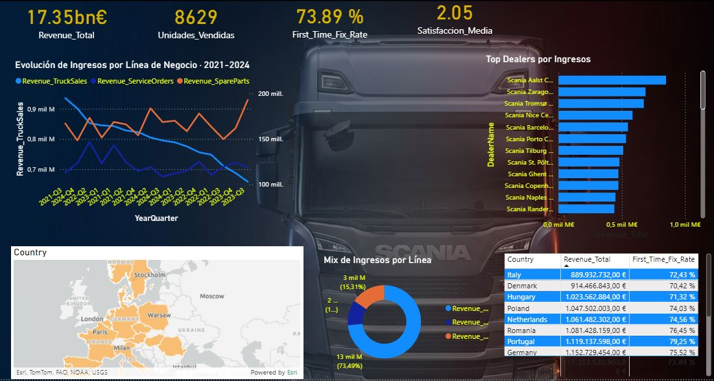
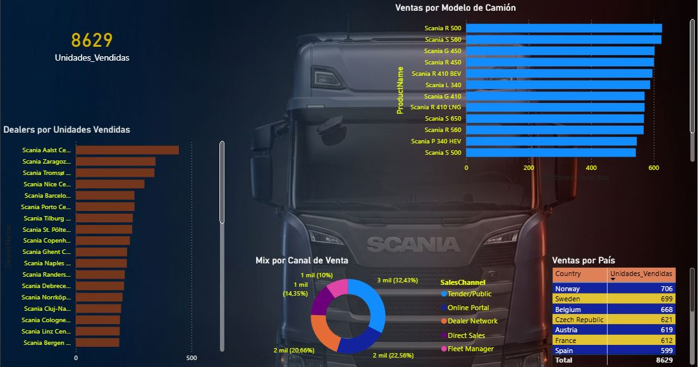
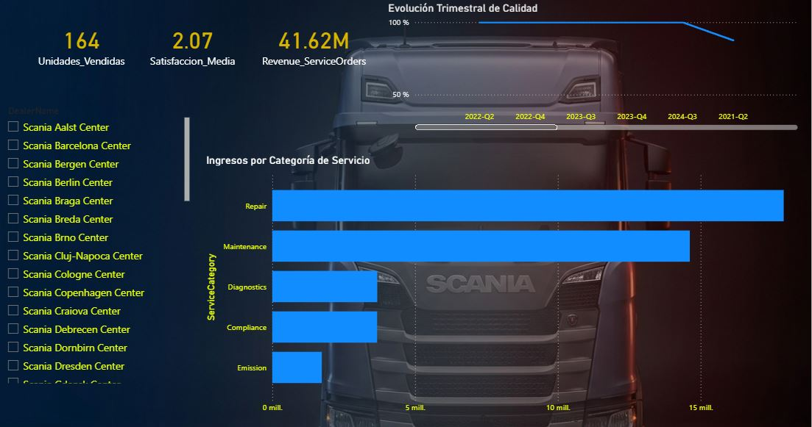
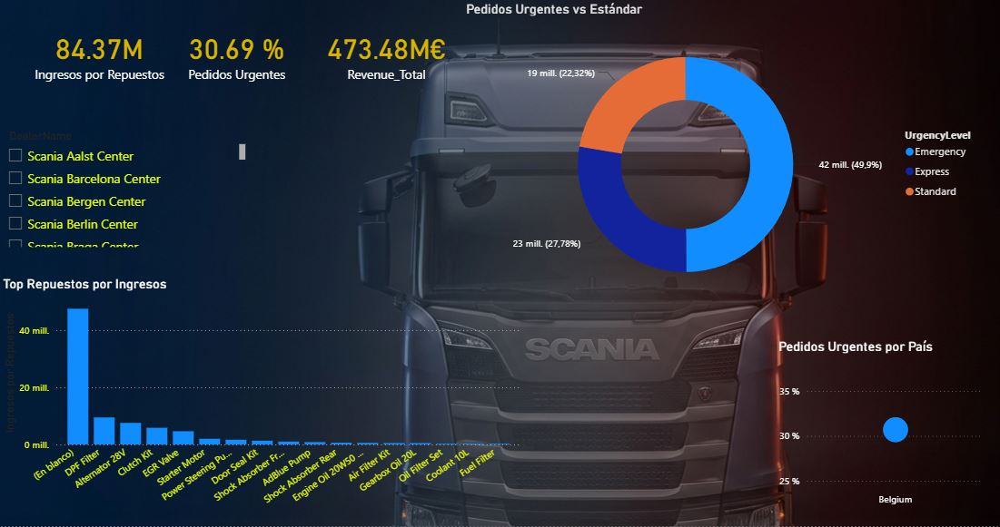

# 📊 Dashboard Ejecutivo – Red de concesionarios de vehículos industriales

**Power BI · DAX Avanzado · Constellation Schema · Early Warning Indicators**

---

## 📋 Descripción del Proyecto

> **Datos 100 % sintéticos.** Proyecto de portfolio inspirado en la operativa de un fabricante de
> camiones; no tiene relación con ninguna empresa real ni utiliza datos de ninguna compañía.

Cuadro de mando ejecutivo para una red ficticia de **54 concesionarios europeos** de vehículos
industriales. Analiza ventas de camiones, operaciones de servicio técnico y cadena de suministro
de repuestos, con alertas automáticas de rendimiento.



---

## 🏗️ Arquitectura del Modelo de Datos

**Tipo:** Constellation Schema (esquema constelación)  
**Motivo:** 3 procesos de negocio independientes que comparten dimensiones

```
                    ┌─────────────────┐
                    │  Dim_Calendario │
                    └────────┬────────┘
                             │
         ┌───────────────────┼───────────────────┐
         │                   │                   │
┌────────▼────────┐ ┌────────▼────────┐ ┌────────▼────────┐
│  Fact_Ventas    │ │  Fact_Servicio  │ │  Fact_Repuestos │
│  Camiones       │ │  Operaciones    │ │  Supply Chain   │
└────────┬────────┘ └────────┬────────┘ └────────┬────────┘
         │                   │                   │
    ┌────▼────┐         ┌────▼────┐         ┌────▼────┐
    │Dim_Modelo│        │Dim_Taller│        │Dim_Pieza│
    └─────────┘         └─────────┘         └─────────┘
              \              │              /
               └──────┬──────┘─────────────┘
                      │
                 ┌────▼────┐
                 │Dim_Dealer│
                 └──────────┘
```

**Tablas:**
| Tabla | Tipo | Registros | Descripción |
|-------|------|-----------|-------------|
| Fact_Ventas_Camiones | Hechos | ~8.000 | Transacciones de venta por modelo y dealer |
| Fact_Servicio_Operaciones | Hechos | ~5.000 | Órdenes de trabajo y tiempos de reparación |
| Fact_Repuestos | Hechos | ~3.500 | Pedidos de repuestos, urgentes vs planificados |
| Dim_Dealer | Dimensión | 54 | Concesionarios europeos con región y país |
| Dim_Modelo | Dimensión | ~30 | Modelos de camión con serie y segmento |
| Dim_Calendario | Dimensión | 1.096 | 3 años con semanas fiscales y trimestres |

---

## 📄 Páginas del Dashboard

### 1. Executive Overview
KPIs globales de la red: ventas totales, ingresos de servicio, fill rate de repuestos. Semáforo de rendimiento vs target trimestral. Comparativa YoY.

### 2. Truck Sales
Análisis de ventas por modelo de camión, dealer, región y trimestre. RANKX de dealers por volumen. Tendencia de ventas rolling 3 meses.

### 3. Service Operations
First Time Fix Rate por taller. Tiempo medio de intervención. Eficiencia técnica por tipo de avería. Alertas EWI si FTFR cae por debajo del 85%.

### 4. Spare Parts – Supply Chain
Ratio pedidos urgentes vs planificados por país. Detección de patrones de rotura de stock. Riesgo en cadena de suministro por dealer y región.

---

## 🧮 Medidas DAX Destacadas

```dax
-- ─────────────────────────────────────────
-- VENTAS Y RENDIMIENTO
-- ─────────────────────────────────────────

Total Ventas =
SUM ( Fact_Ventas_Camiones[Precio_Venta] )

-- Estado numérico (1 / 0 / -1) para formato condicional con iconos.
-- Sin objetivo devuelve BLANK: en DAX, BLANK >= 0 es VERDADERO y
-- sin esta comprobación un mes sin objetivo aparecería en verde.
Estado Ventas =
VAR _target   = [Target Ventas Trimestre]
VAR _varianza = DIVIDE ( [Total Ventas] - _target, _target )
RETURN
    SWITCH (
        TRUE (),
        ISBLANK ( _target ),  BLANK (),
        _varianza >= 0,       1,     -- en objetivo
        _varianza >= -0.05,   0,     -- atención
        -1                           -- por debajo
    )

-- ─────────────────────────────────────────
-- TIME INTELLIGENCE
-- ─────────────────────────────────────────

Ventas YoY % =
VAR _actual   = [Total Ventas]
VAR _anterior = CALCULATE ( [Total Ventas], SAMEPERIODLASTYEAR ( Dim_Calendario[Fecha] ) )
RETURN DIVIDE ( _actual - _anterior, _anterior )

-- Ventana anclada a la última fecha con ventas: evita ventanas vacías
-- cuando el calendario se extiende más allá de los datos.
Rolling 3M Ventas =
VAR _ultimaFechaConDatos =
    CALCULATE ( MAX ( Fact_Ventas_Camiones[Fecha] ), ALL ( Dim_Calendario ) )
VAR _fechaRef =
    MIN ( MAX ( Dim_Calendario[Fecha] ), _ultimaFechaConDatos )
RETURN
    CALCULATE (
        [Total Ventas],
        DATESINPERIOD ( Dim_Calendario[Fecha], _fechaRef, -3, MONTH )
    )

-- ─────────────────────────────────────────
-- SERVICE OPERATIONS
-- ─────────────────────────────────────────

First Time Fix Rate =
DIVIDE (
    CALCULATE ( COUNTROWS ( Fact_Servicio_Operaciones ),
                Fact_Servicio_Operaciones[Intentos_Reparacion] = 1 ),
    COUNTROWS ( Fact_Servicio_Operaciones )
)

EWI FTFR =
VAR _ftfr = [First Time Fix Rate]
RETURN IF ( NOT ISBLANK ( _ftfr ), IF ( _ftfr < 0.85, -1, 1 ) )

-- ─────────────────────────────────────────
-- RANKING (respeta los filtros del usuario y no puntúa el total)
-- ─────────────────────────────────────────

Ranking Dealer Ventas =
IF (
    ISINSCOPE ( Dim_Dealer[Nombre_Dealer] ) && NOT ISBLANK ( [Total Ventas] ),
    RANKX ( ALLSELECTED ( Dim_Dealer[Nombre_Dealer] ), [Total Ventas], , DESC, DENSE )
)

-- ─────────────────────────────────────────
-- SUPPLY CHAIN REPUESTOS
-- ─────────────────────────────────────────

% Pedidos Urgentes =
DIVIDE (
    CALCULATE ( COUNTROWS ( Fact_Repuestos ), Fact_Repuestos[Tipo_Pedido] = "Urgente" ),
    COUNTROWS ( Fact_Repuestos )
)

EWI Riesgo Repuestos =
VAR _urg = [% Pedidos Urgentes]
RETURN
    SWITCH (
        TRUE (),
        ISBLANK ( _urg ), BLANK (),
        _urg > 0.30,      -1,   -- riesgo elevado
        _urg > 0.15,      0,    -- monitorizar
        1                       -- normal
    )
```

> **Lógica separada de la presentación:** las medidas de estado devuelven 1 / 0 / -1 y el color
> o icono se asigna en Power BI con *Formato condicional → Iconos → Basado en reglas*. La misma
> medida sirve para tablas, tarjetas y alertas.

---

## 📸 Capturas

| Executive Overview | Truck Sales |
|---|---|
|  |  |
| **Service Operations** | **Spare Parts** |
|  |  |

---

## 🔑 Aprendizajes Técnicos

- **Constellation Schema** vs Star Schema: cuándo usar múltiples tablas de hechos que comparten dimensiones
- **USERELATIONSHIP** para activar relaciones inactivas entre tablas de hechos y el calendario
- **Row-level Security** por región de dealer
- **Performance Analyzer** para optimizar medidas lentas en tablas de +16.000 filas
